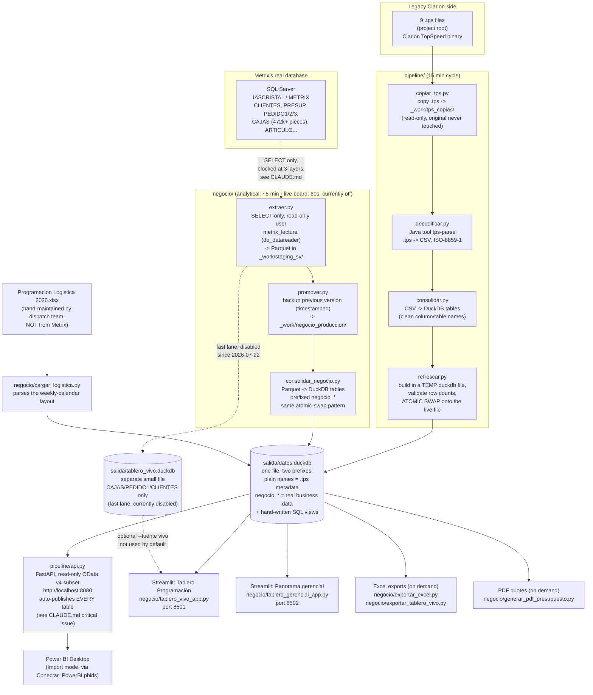

# Architecture — how data flows through this project

Read `../CLAUDE.md` first if you haven't. This file explains the end-to-end
data flow: which file does what, and why it's built this way.

## The big picture

There are **two independent pipelines** that both end up in the same local
database file, `salida/datos.duckdb`, using different table-name prefixes so
they never collide:

1. **`pipeline/`** — decodes the 9 legacy `.tps` files in the project root.
   These turned out to hold Metrix's *internal report-engine metadata*
   (which SQL each of Metrix's 243 built-in reports uses, column layouts,
   etc.) — **not real business data**. Tables land with their plain names
   (`columnas`, `consulta`, `informes`, `infxusu`, `origenes`, `scripts`,
   `variable`, `infgcial`; `temprpt` is currently excluded, see below).
2. **`negocio/`** — reads the real business data directly from Metrix's SQL
   Server database (clients, quotes, orders, the piece-tracking table).
   Tables land prefixed `negocio_*` (e.g. `negocio_cajas`, `negocio_pedido1`).

Both pipelines are read-only all the way back to their source, and both use
the same "build a new file, then swap" pattern so the API is never down or
serving half-written data during a refresh (details below).

## Diagram

## Why two pipelines, one database file

Early in this project, it looked like the `.tps` files *were* the business
data. Investigation showed the opposite: Metrix's real client/quote/order/
production data has always lived in SQL Server, and the `.tps` files are just
the metadata Metrix's own report engine uses internally. Rather than throw
away the working `.tps` pipeline, both were kept and merged into one DuckDB
file with prefixes, so:
- **One OData API serves everything** to Power BI — new `negocio_*` tables or
  SQL views appear automatically (the API reads `information_schema` live,
  no code change needed to expose a new table).
- Both pipelines can fail or refresh independently without affecting the
  other's tables.

## Why "atomic swap" everywhere

Every refresh (both pipelines) follows the same shape:
1. Copy the currently-live DuckDB file to a temp file (so existing tables from
   the *other* pipeline, and hand-written SQL views, aren't lost).
2. Load fresh data into that temp file only. This can take 10 seconds
   (`.tps`) to a few minutes (`negocio_cajas`, ~472k rows).
3. Only once loading succeeds, atomically replace the live file
   (`os.replace`, with retries — Windows can transiently refuse to replace a
   file another process has it open, hence the retries in
   `pipeline/bitacora.py::reemplazar_archivo_con_reintentos`).

This exists because early versions kept the live file open read-write for the
whole loading window — during which the API (which also needs to open that
file) would fail every request. A Power BI refresh landing in that window
would reject the *entire* service with a generic "not a valid OData source"
error. The atomic-swap fix means the API is never down for a refresh, however
long it takes.

## Why the live board (`tablero_vivo.duckdb`) is a separate file

The Streamlit "Tablero Programación" board was originally meant to refresh
every 60 seconds from a fast, narrow extraction (`negocio/ciclo_vivo.py`,
only `CAJAS`/`PEDIDO1`/`CLIENTES`, fewer columns). That's a separate DuckDB
file specifically so a 1-minute refresh never competes for the same file lock
as the ~5-minute analytical cycle. **As of 2026-07-22 this fast lane is
disabled** (see `negocio/servicio.py` docstring) — it was found to be a likely
cause of pipeline slowdowns, and the dashboard now reads the same "backup"
(analytical) source as everything else, which has all the tables it needs
(`ARTICULO`, `PEDIDO2` — the fast lane doesn't extract those). The old
`--fuente vivo` code path still works if anyone reactivates `ciclo_vivo.py`.

## Read-only enforcement — three independent layers

1. **Database role**: the login `metrix_lectura` used for all SQL Server
   reads has only the `db_datareader` role (`salida/crear_usuario_solo_lectura.sql`)
   — SQL Server itself refuses any write from this account, regardless of
   what the code does.
2. **Code-level guard**: `negocio/conexion.py::_validar_solo_lectura` regex-
   checks every SQL string before it's sent — must start with `SELECT`/`WITH`,
   and is rejected if it contains `INSERT`/`UPDATE`/`DELETE`/`ALTER`/`DROP`/etc.
   anywhere, even in a subquery.
3. **Isolation level**: every connection sets
   `SET TRANSACTION ISOLATION LEVEL READ UNCOMMITTED` plus
   `ApplicationIntent=ReadOnly` in the connection string — chosen deliberately
   (see `salida/decision_aislamiento_sql.md`) so a long read (extracting
   ~472k rows from `CAJAS` takes minutes) never takes locks that could block
   shop-floor staff actively using Metrix. The tradeoff (might read an
   in-progress edit) was judged acceptable because this feeds dashboards/
   reports, not financial transactions, and self-corrects on the next cycle.

The `.tps` side has a simpler guarantee: `pipeline/copiar_tps.py` only ever
calls `shutil.copy2()` to read the originals, and the rest of the pipeline
operates on that copy — the production `.tps` files in the project root are
never opened for writing by this codebase.

## File formats at each stage

| Stage | Format |
|---|---|
| `.tps` source | Clarion TopSpeed binary, `ISO-8859-1` (Latin-1) encoded |
| `.tps` decoding | Java tool `tps-parse` (`_work/herramientas/tps-to-csv.jar`), run via a JRE 21 install |
| Intermediate (`.tps` side) | CSV, UTF-8, in `_work/csv_out/` |
| Intermediate (`negocio/` side) | Parquet, in `_work/staging_sv/` then `_work/negocio_produccion/` (with timestamped backups in `_work/negocio_backups/`) |
| Consolidated storage | DuckDB (`salida/datos.duckdb`, `salida/tablero_vivo.duckdb`) |
| API wire format | JSON over HTTP, OData v4 subset (`pipeline/api.py`) |
| Power BI | Import mode over the OData feed — DirectQuery is not supported against this API |
| Dashboards | Streamlit reads DuckDB directly (no API hop) |
| One-off exports | `.xlsx` (openpyxl) and `.pdf` (fpdf) — a "photo," not a live connection |

## Ports in use on this machine

| Port | What | Started by |
|---|---|---|
| 8080 | OData API (`pipeline/api.py`) | Scheduled task `Metrix_ServicioOData` |
| 8501 | Streamlit "Tablero Programación" (piece-level) | Scheduled task `Metrix_TableroVivo` |
| 8502 | Streamlit "Panorama gerencial" (management) | **Not yet scheduled** — run manually, see `docs/RUNBOOK.md` |
| 8090 | `salida/arbol_db.html` (a generated database schema browser) | Started manually; stopped via `Detener_ArbolDB.bat` |
| 1433 | SQL Server `IASCRISTAL` (external, not part of this project) | Metrix's own infrastructure |

8080 and 8090 are additionally opened to the office LAN (not the public
internet) via Windows Firewall rules — see `salida/acceso_red_local.md`.
**8080 currently also exposes the `origenes` table — see the critical issue
in `../CLAUDE.md` before treating this as fully safe.**

## What's proposed but not built

- **PostgreSQL / DirectQuery support** (`pipeline/consolidar.py::cargar_en_postgres`)
  — stubbed out, deliberately left unimplemented; not needed at the current
  data volume.
- **Change-audit tool** (diffing timestamped `_work/negocio_backups/` snapshots
  to build a "what changed, when" log) — designed in
  `salida/propuesta_auditoria_cambios.md`, not built. Needs a controlled test
  (a known manual change in Metrix, confirmed to show up in the next diff)
  before being trusted.
- **KPI trend history** — none of the management-dashboard KPI views store
  daily snapshots today, so "is this going up or down" isn't answerable yet.
  Would need a new `historial_kpis` table written once a day.
- **`Metrix_TableroGerencial` scheduled task / firewall rule** — the app
  works, just isn't wired into Windows startup yet.
